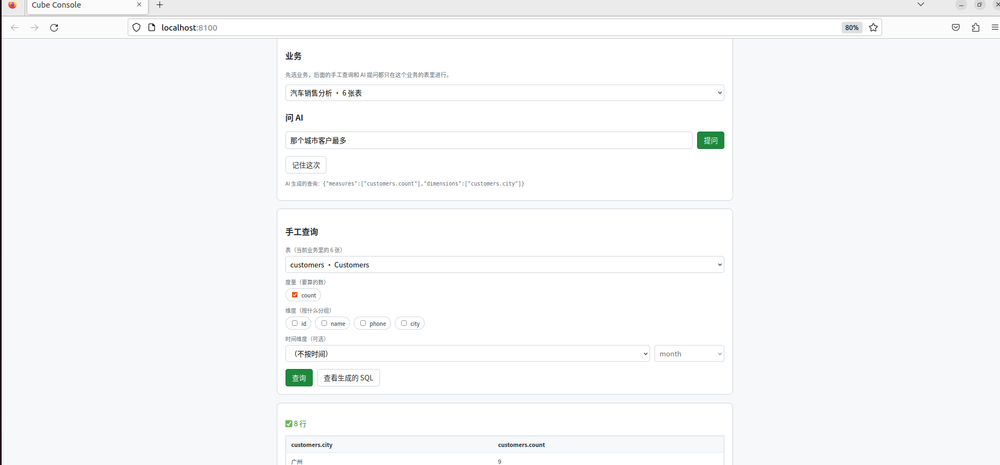
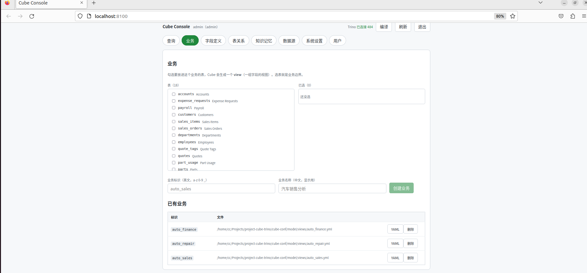
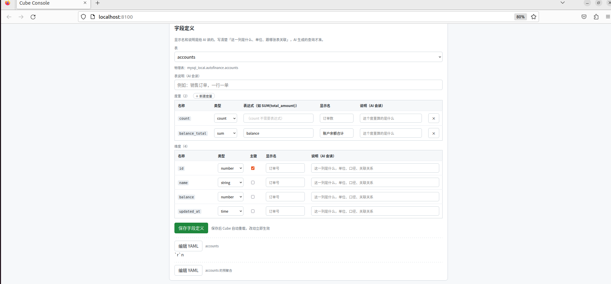
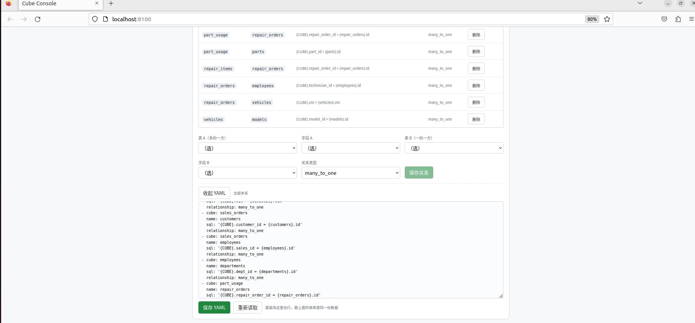
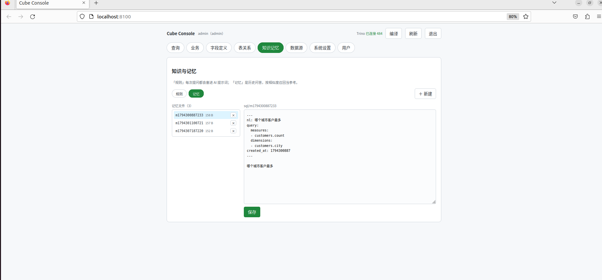

# Cube Console

> 先选表建「业务」，填好字段和关系，然后用人话提问 —— AI 把问题翻译成查询并执行。

一个自托管的**语义层控制台**：**Cube** 做语义层（指标、维度、关系、预聚合），**Trino** 做联邦查询，网页里点选就能建业务、配字段、定关系，最后用中文问数据。



## 它解决什么

```
MySQL（销售/财务/人力） + PostgreSQL（仓储/维修/配件）
              ↓  Trino 联邦（跨库 JOIN）
       一次配置，所有库都能查
              ↓  Cube 语义层（表 → cube → 业务视图）
   选表建业务 → 填中文名和说明 → 配关系 → 定指标
              ↓
        用中文提问：哪个城市客户最多
              ↓
   AI 生成查询 JSON（不是 SQL）→ Cube 执行 → 出结果
```

## 和「让 AI 直接写 SQL」的区别

| | AI 直接写 SQL | Cube Console |
|---|---|---|
| AI 输出 | SQL 文本 | **查询 JSON**（measures / dimensions） |
| 表名字段名 | 可能编错 | 只能从元数据里选，编不出来 |
| 口径一致性 | 每次可能不同 | 指标定义固定，永远同一口径 |
| 跨库 | 要人肉拼 | Trino 自动 |
| 性能 | 每次都打数据库 | 预聚合命中后毫秒级 |

## 界面

8 个标签，按建模顺序排：

| 标签 | 做什么 |
|---|---|
| **查询** | 选业务 → 问 AI / 手工勾字段 / 看生成的查询 |
| **业务** | 勾表组合成一个 view（业务边界） |
| **字段定义** | 表说明、字段中文名、说明、指标（`SUM(x)`）、预聚合 |
| **表关系** | 两张表怎么 join（全局一份 YAML） |
| **知识记忆** | 业务规则（每次提问都带）+ 历史问答（相似召回） |
| **数据源** | 填 MySQL/PostgreSQL → 自动写 Trino catalog + 重启 + 生成模型 |
| **系统设置** | AI 接口、查询参数 |
| **用户** | admin / editor / viewer |









## 快速开始

需要 **Java 24+**、**Python 3.11+**、**Docker**。

```bash
tar -xzf cube-console-linux.tar.gz
cd project-cube-trino
./install.sh      # 装依赖 + 拉 Cube 镜像
./start.sh        # 起 Trino + Cube + 后端，打印三个地址
```

打开 `http://localhost:8100`，账号 `admin` / `admin123`。

## 第一次用（按顺序）

1. **数据源** → 填你的 MySQL / PostgreSQL → 保存
   （自动：写 Trino catalog、重启 Trino、扫描建模型）
2. **业务** → 勾表 → 起个中文名
3. **表关系** → 选表A字段A、表B字段B → 保存（表 A 是「多」的一方）
4. **字段定义** → 给字段填中文名和说明（**AI 靠这个理解你的业务**）
5. **知识记忆** → 写业务规则，例如「销售额一律用 item_amount」
6. **查询** → 选业务 → 直接问

## 架构

```
浏览器 (Vue)
   ↓ REST
FastAPI 后端 ──写──→ cube-conf/model/*.yml ──读──→ Cube (:4000)
   │                                                  ↓
   │                                            Trino (:8888)
   └── /api/cube/ask ── LLM ──→ 查询 JSON ──→ Cube ──→ MySQL / PostgreSQL
```

**没有自己的数据库**：账号、数据源、模型全是文件。

## 目录

```
project-cube-trino/
├── app/backend/         FastAPI
│   └── app/
│       ├── main.py          登录、配置、数据源
│       ├── api/cube_api.py  Cube 集成（模型/关系/知识/查询/提问）
│       └── core/
│           ├── cube_models.py   扫 Trino 生成模型
│           ├── trino_sql.py     查 Trino
│           └── trino_admin.py   写 catalog + 重启 Trino
├── frontend/            Vue3 + Vite（8 个页面）
├── cube-conf/           Cube 的模型目录（挂进容器）
│   ├── model/cubes/all.yml   所有 cube
│   ├── model/views/*.yml     业务视图
│   └── knowledge/{rules,sql} 规则和记忆
├── config/              账号、数据源、AI 配置
└── web/                 前端构建产物（后端直接托管）
```

## 端口

| 端口 | 服务 |
|---|---|
| 8100 | 网页 + API |
| 4000 | Cube（Playground / REST API） |
| 8888 | Trino（UI 在 `/ui`） |
| 15432 | Cube 的 SQL 接口 |

## 实现要点

**① 模型自动生成，且不覆盖你的编辑**

数据源增删后自动扫 Trino 重建模型：

- 已存在的 cube：保留 `title` / `description` / `measures` / `joins`，只同步列
- 新表：生成 `row_count` + 每列一个维度
- Trino 里没了的表：从模型移除

**② AI 只输出 JSON**

```json
{"measures":["sales_orders.sales_amount"],
 "dimensions":["customers.city"],
 "timeDimensions":[{"dimension":"sales_orders.order_date","granularity":"month"}]}
```

字段名必须来自元数据，写错 Cube 直接报错，不会静默查错数据。

**③ 业务范围隔离**

提问时把当前业务的表清单塞进提示词，AI 不可能跨业务选字段。

**④ 关系和 YAML 一处维护**

Cube 的 joins 散在各 cube 里，但界面上是一份全局 YAML：

```yaml
joins:
  - cube: sales_orders
    name: customers
    sql: '{CUBE}.customer_id = {customers}.id'
    relationship: many_to_one
```

保存时后端按 cube 分组拆回，删除即清空。

## 常见问题

**保存数据源后表没出现** —— 等 10 秒（Trino 在重启），再点顶栏「编译」。

**AI 答不准** —— 去「字段定义」把中文名和说明写清楚，比换模型有效。

**改完 YAML 不生效（生产模式）** —— 点顶栏「编译」，它会重建模型并重启 Cube。

**Cube 连不上** —— `docker ps` 看 `cube` 容器；不在就 `./start.sh`（会自动创建）。

## License

MIT。第三方：Cube（Apache-2.0）、Trino（Apache-2.0）、FastAPI（MIT）、Vue（MIT）。
