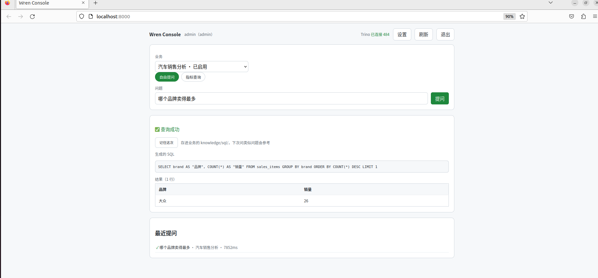
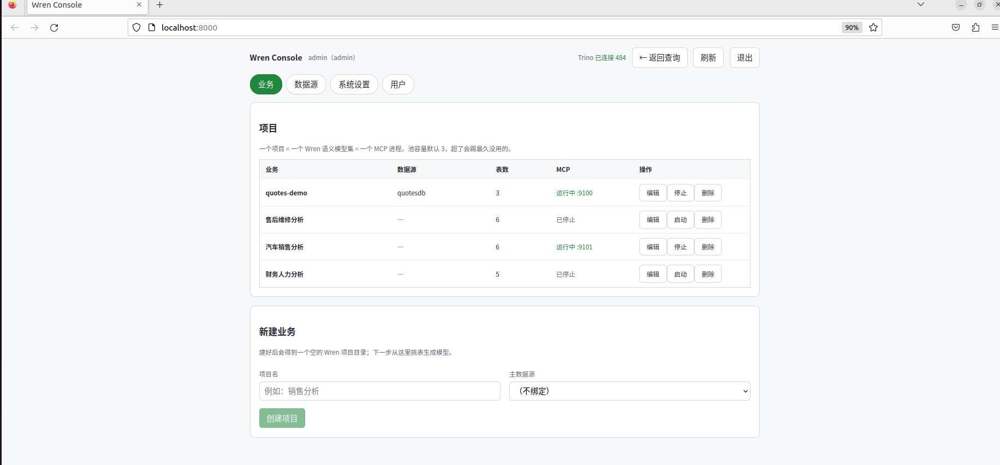
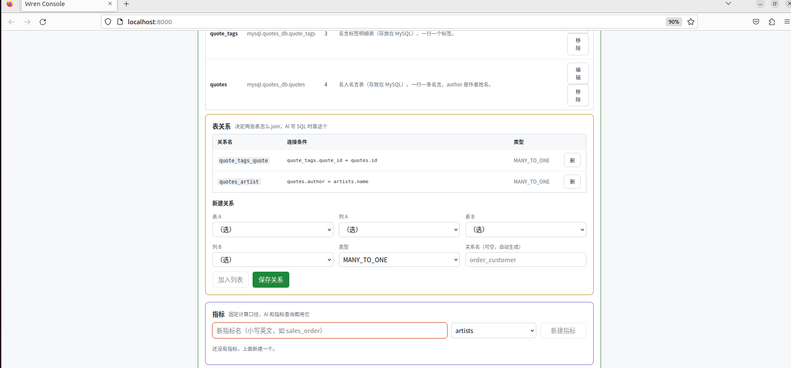
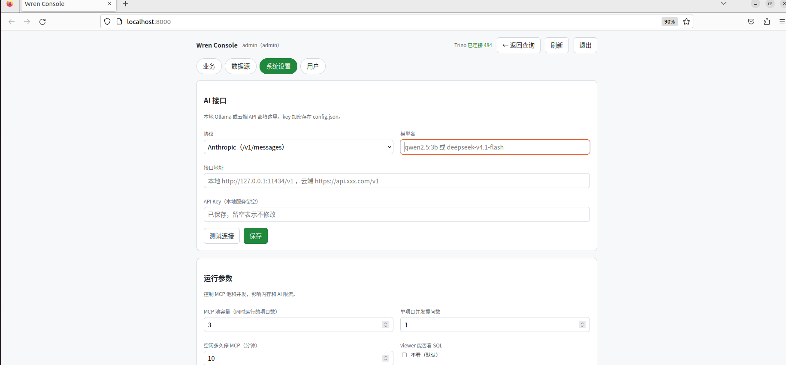

# Wren Console

> 把散落在多个数据库里的表，变成「AI 能直接问」的业务语义模型。

> ⚠️ 早期项目，API 和数据结构可能变动。



一个自托管的语义层控制台：**Trino** 做联邦查询，**Wren** 做语义建模，网页里点选就能建业务、配关系、定指标，然后用人话提问——或者把 MCP 地址给你的 AI 客户端。

```
MySQL（销售 / 财务 / 人力）  +  PostgreSQL（仓储 / 维修 / 配件）
                        ↓  Trino 联邦（跨库 JOIN）
                 一个实例，所有表都能一起查
                        ↓  Wren 语义层（表 → 业务模型 → 指标 → 记忆）
        ┌───────────────┼───────────────┐
   网页自由提问      网页指标查询      MCP 网关
   （AI 写 SQL）    （cube 口径，最快）  （Claude / Cursor / Cline）
```

## 特点

- **不用数据库存元数据**：全部是文件（JSON + YAML），可备份、可 diff、可手改
- **一个业务一个目录**：就是标准 Wren 项目，能直接用 `wren` 命令操作
- **表单化建模**：表 / 关系 / 指标都有图形编辑器，YAML 只是兜底
- **指标固化口径**：同一个「销售额」，永远按 `SUM(total_amount)` 算，不让 AI 每次瞎猜
- **AI 只建议不落盘**：描述、关系、指标都要人点确认
- **三级权限**：admin（数据源+账号）/ editor（建模）/ viewer（只读提问）

## 需要什么

| 依赖 | 版本 | 用途 |
|---|---|---|
| Java | **24+** | 跑 Trino（Ubuntu 22.04 自带的 21 不够） |
| Python | **3.11+** | 跑后端和 Wren |
| Node | 18+（可选） | 只有重新构建前端时才需要 |

## 快速开始

```bash
git clone <this-repo>
cd wren-console
./scripts/install.sh     # 检查环境 → 下载 Trino → 装 Python 依赖 → 构建前端
./scripts/start.sh
```

打开 **http://localhost:8000**，默认 `admin` / `admin123`（**登录后请立刻改**）。

停止：`./scripts/stop.sh`

## 造一套演示数据（可选）

想立刻有数据可玩，先在本机准备好 MySQL 和 PostgreSQL，然后：

```bash
.venv/bin/python scripts/seed_autodemo.py
```

会在你的 MySQL / PostgreSQL 里建出 6 个库：

| 库 | 内容 |
|---|---|
| `autostaff`（MySQL） | 部门、员工 |
| `autosales`（MySQL） | 客户、销售订单、明细 |
| `autofinance`（MySQL） | 工资、资金申请、账户 |
| `autowarehouse`（PG） | 车型、库存车、移库 |
| `autoparts`（PG） | 零件、工具、领用 |
| `autorepair`（PG） | 维修工单、维修项 |

> 脚本里的数据库账号密码是演示用的（`wren` / `wren123`），生产环境请自己改。

## 用法

1. **设置 → 数据源**：填主机 / 端口 / 账号 → 测试连接 → 保存（自动注册成 Trino catalog）
2. **设置 → 业务**：新建业务 → 编辑 → 加入表 → 填列描述 → 配关系 → 建指标 → 编译
3. **首页**：选业务 → 自由提问，或走「指标查询」
4. **设置 → 系统设置**：配 AI（云端 API 或本地 Ollama）
5. **设置 → 用户**：建账号、改角色、重置密码





### 关于「数据源」的一个细节

| 数据库 | 一个数据源覆盖范围 |
|---|---|
| MySQL / MariaDB | **整台服务器**（所有库都变成 Trino 的 schema） |
| PostgreSQL / SQL Server | **只能一个库**（要多个库就建多个数据源） |



## 外部 AI 接入

MCP 网关提供三个工具：`list_projects` / `get_project_schema` / `ask(question, project)`。

| 客户端 | 填哪个地址 |
|---|---|
| Cline（VSCode 插件） | `http://localhost:9301/sse` |
| Claude Desktop / Cursor | `http://localhost:9300/mcp` |

Cline 的 `cline_mcp_settings.json`：

```json
{
  "mcpServers": {
    "wren-console": {
      "url": "http://localhost:9301/sse",
      "disabled": false
    }
  }
}
```

## 目录结构

```
wren-console/
├── backend/            FastAPI + Wren 封装
│   └── app/
│       ├── main.py         装配、登录、配置、数据源
│       ├── api/            业务 / 建模 / 问答 / 文件
│       ├── core/           Wren 项目、MCP 池、Trino、MDL 生成
│       ├── gateway.py      MCP 网关
│       └── llm.py          AI 探测与对话
├── frontend/           Vue3 + Vite
├── scripts/
│   ├── install.sh      一次性安装
│   ├── fetch_trino.sh  下载并裁剪 Trino
│   ├── start.sh        启动
│   ├── stop.sh         停止
│   └── seed_autodemo.py 造 6 个演示库
├── runtime/            Trino（fetch_trino.sh 生成，不入库）
├── web/                前端构建产物（不入库）
├── data/               配置和账号（不入库）
└── businesses/         业务（不入库）
```

## 端口

| 端口 | 用途 |
|---|---|
| 8000 | 网页 + REST API |
| 8888 | Trino |
| 9300 | MCP（streamable-http） |
| 9301 | MCP（SSE） |

## 常见问题

**Java 版本太低**

Trino 需要 Java 24+。Ubuntu 22.04 默认只有 21，从 [Adoptium](https://adoptium.net) 下 tar.gz 解压后加进 PATH。

**Python 装在非标准路径**

```bash
PYTHON=/opt/python3.11/bin/python3.11 ./scripts/install.sh
```

**国内装依赖慢**

```bash
PIP_INDEX_URL=https://pypi.tuna.tsinghua.edu.cn/simple ./scripts/install.sh
```

**Trino 下载慢**

`scripts/fetch_trino.sh` 默认走阿里云 Maven。换版本：

```bash
TRINO_VERSION=476 bash scripts/fetch_trino.sh
```

**页面能打开但一提问就 500**

多半是 `wren` 命令跑不起来，测一下：

```bash
.venv/bin/wren --version      # 应输出 wrenai 0.17.1
```

**改了目录名以后起不来**

目录里有三处绝对路径：`start.sh` 的 ROOT、venv 里脚本的 shebang、Trino 的 `node.properties`。改完目录要同步改这三处。

**不要设置 `WREN_HOME` 环境变量**

那是 Wren 自己用的（它凭这个找 `profiles.yml`）。本项目的根目录变量叫 `WC_HOME`。

## 安全提醒

- 默认管理员密码是 `admin123`，**部署后第一件事就是改掉**
- MCP 网关**没有认证**，只适合本地或可信内网；不要直接暴露到公网
- `.env` 里的 `MASTER_KEY` 用来加密数据源密码，换掉会导致旧密码解不开

## 技术栈

Trino 484 · Wren 0.17.1 · FastAPI · Vue 3 · Vite · LanceDB（记忆索引）

## License

MIT。第三方组件遵循各自许可：Trino（Apache-2.0）、Wren（Apache-2.0）、FastAPI（MIT）、Vue（MIT）。